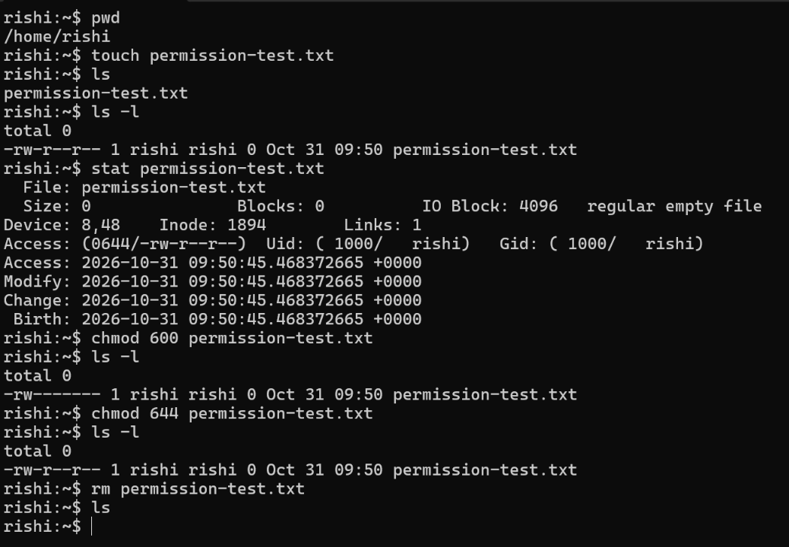

# Linux File Permissions

**Section:** Foundations  
**Focus:** File metadata, permission modes, changing permissions, and file removal

## Objective

Practise creating a file, inspecting its permissions and metadata, changing its permission mode with `chmod`, and removing it.

## Environment

- **Operating system:** Ubuntu running under WSL2
- **Shell:** Bash

## Commands Practised

| Command | What it does | Why it is useful |
|---|---|---|
| `pwd` | Prints the current working directory. | Confirms where files are being created or modified. |
| `touch permission-test.txt` | Creates an empty file if it does not exist. | Provides a test file for permission exercises. |
| `ls` | Lists directory entries. | Confirms that the file exists. |
| `ls -l` | Displays a detailed listing, including permission bits, owner, group, size, and modification time. | Provides a quick view of file permissions and ownership. |
| `stat permission-test.txt` | Displays detailed file metadata, including numeric and symbolic access permissions, ownership, inode, and timestamps. | Gives a more complete view of file metadata than a basic directory listing. |
| `chmod 600 permission-test.txt` | Sets read/write permissions for the owner and removes permissions for group and others. | Restricts access to the file owner. |
| `chmod 644 permission-test.txt` | Sets read/write permissions for the owner and read-only permissions for group and others. | Demonstrates a common permission mode for non-sensitive files intended to be readable by other users. |
| `rm permission-test.txt` | Removes the file. | Cleans up the temporary test file after the exercise. |

## Understanding the Permission Changes

Linux permission modes use three groups: **owner**, **group**, and **others**. Each group can have read (`r`), write (`w`), and execute (`x`) permissions.

- **0644** → owner: read/write; group: read; others: read (`-rw-r--r--`).
- **0600** → owner: read/write; group: no access; others: no access (`-rw-------`).

The screenshot shows the file initially created with mode **0644**, changed to **0600**, and then restored to **0644** before deletion.

## Practical Evidence

The screenshot below captures the file creation, permission inspection, permission changes, and cleanup.

## Key Takeaways

The `ls -l` and `stat` commands help inspect file permissions and ownership. The `chmod` command changes access permissions, while numeric modes such as `600` and `644` provide a compact way to define them.

An important distinction: deleting a file is generally controlled by write and execute permissions on its parent directory, not by the file's own write bit.

## Scope

This was a foundational exercise in my own Ubuntu/WSL2 environment. It involved a temporary test file and no access to external systems.
