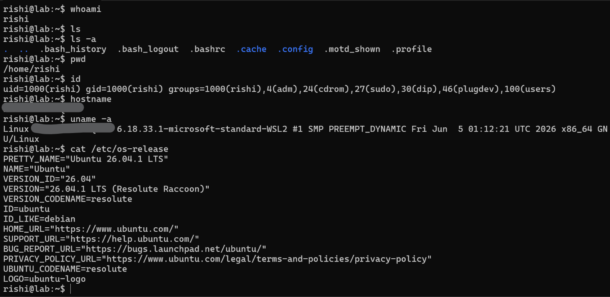

# Lab 00 — Linux Fundamentals

## Objective

Practise essential Linux commands for identifying the current user, exploring the filesystem, and inspecting user and system information.

## Environment

- **Operating system:** Ubuntu 26.04.1 LTS
- **Environment:** Windows Subsystem for Linux 2 (WSL2)
- **Shell:** Bash

## Commands Practised

| Command | What it does | Why it is useful |
|---|---|---|
| `whoami` | Prints the effective username of the current session. | Identifies which account is executing commands. |
| `id` | Displays the user ID (UID), primary group ID (GID), and supplementary group memberships. | Helps understand account identity and group-based permissions. |
| `hostname` | Displays the system's configured hostname. | Identifies the host being used during administration or investigation. |
| `uname -a` | Prints kernel and system information, including the kernel release and architecture. | Helps identify the operating environment and kernel version. |
| `cat /etc/os-release` | Prints operating-system identification data. | Identifies the Linux distribution and release. |
| `pwd` | Prints the current working directory. | Confirms the current working directory. |
| `ls` | Lists non-hidden entries in the current directory. | Provides a quick view of directory contents. |
| `ls -a` | Lists all entries, including hidden files and directories (names beginning with a dot). | Helps discover configuration files and other hidden entries. |

## Key Observations

- The current account was reported as `rishi`, with UID `1000` and primary GID `1000`.
- The account belonged to supplementary groups including `sudo`.
- The environment was Ubuntu 26.04.1 LTS running under WSL2.
- The kernel information identified a Microsoft WSL2 kernel on an x86_64 system.

**Permission note:** Membership in the `sudo` group indicates that the account is configured for sudo access, subject to the system's sudo policy. It does not mean the current shell is running as root.

## Practical Evidence

The screenshot below records the commands executed and their terminal output. The hostname is redacted in the evidence image.

[View the original evidence file](./evidence/lab_00-linux-fundamentals.png)

## Key Takeaways

These commands provide a basic first look at a Linux environment: who is executing commands, which groups the account belongs to, where the shell is located, and which operating system and kernel are in use. This information is useful during system administration, host enumeration, and security investigations.

## Scope

This was a fundamentals exercise in my own Ubuntu/WSL2 environment. The commands are informational and do not, by themselves, demonstrate a security vulnerability or an independent penetration test.
