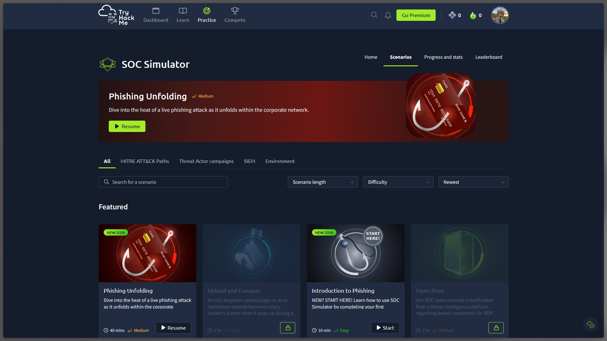

# SOC03 — Phishing Unfolding (SOC Simulator)

**Platform:** [TryHackMe SOC Simulator](https://tryhackme.com/soc-sim/scenarios)  
**Scenario:** Phishing Unfolding  
**Status:** In progress  
**Difficulty shown by platform:** Medium  
**Estimated duration shown by platform:** 40 minutes

## Overview

This is an unguided, scenario-based SOC simulation centred on investigating a phishing incident as it unfolds within a corporate network.

I started the scenario and approached it using my existing cybersecurity knowledge. I also used AI assistance to understand unfamiliar concepts and reason about parts of the investigation where my experience was limited.

The scenario is **not completed**. I paused while high-level alerts remained unresolved because I did not yet have enough knowledge to investigate them confidently. I am documenting the current progress honestly rather than presenting an incomplete exercise as a solved investigation.

## Progress so far

- Started the Phishing Unfolding scenario.
- Began reviewing the alerts and scenario information.
- Applied prior knowledge to understand the investigation context.
- Used AI assistance to clarify unfamiliar concepts and possible investigation paths.
- Paused with high-level alerts still remaining.

## Learning objectives

This scenario is helping me understand the workflow of a SOC analyst:

- Triage incoming alerts and prioritise investigation based on severity, context, and potential impact.
- Correlate email activity with user, endpoint, and network evidence.
- Distinguish an alert from a validated finding.
- Record observations, hypotheses, confidence, and unresolved questions.
- Recognise when additional knowledge or escalation is required.

## Current limitation

I do not yet have enough practical experience to confidently assess all remaining high-level alerts. This is a learning gap, not a finding about the simulated environment. I will revisit the scenario after strengthening my knowledge of phishing analysis, email artefacts, endpoint telemetry, and alert correlation.

## Evidence

The screenshot below records the scenario in progress. It demonstrates that the simulation was started; it is **not** evidence of completion or of any particular alert disposition.

## Scope and assistance disclosure

This is a training simulation, not a real-world incident-response engagement. I used prior knowledge and AI assistance to understand concepts and work through unfamiliar parts of the scenario. The investigation is incomplete, and no claim is made that all alerts have been triaged or resolved.

## Next steps

1. Review alert severity, priority, and triage methodology.
2. Strengthen phishing fundamentals: sender identity, email headers, URLs, attachments, and user interaction.
3. Practise correlating email, endpoint, and network telemetry.
4. Resume the scenario and document each alert with supporting evidence, reasoning, confidence, and disposition.
