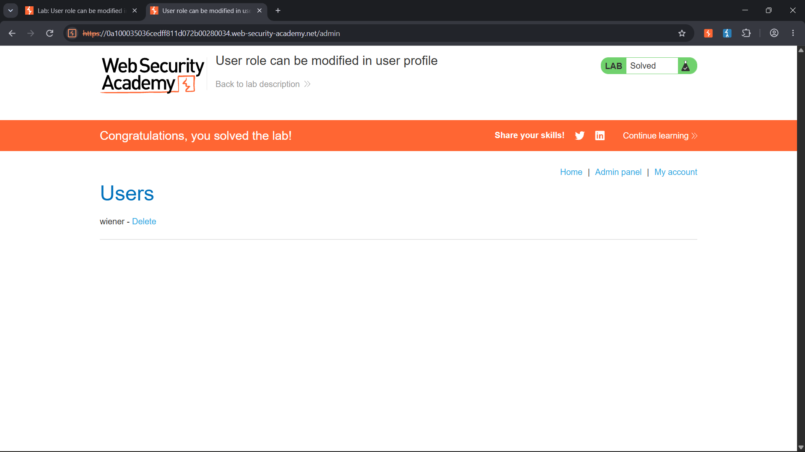

# User Role Can Be Modified in User Profile

**Platform:** PortSwigger Web Security Academy  
**Topic:** Access Control — Privilege Escalation / Mass Assignment  
**Difficulty:** Apprentice  
**Status:** Solved

## Lab objective

The objective was to gain access to the administrator panel and delete the user `carlos`.

I logged in as the normal user `wiener` and explored the application before moving to request-level testing. My initial checks included:

- Exploring the available pages and URL paths.
- Inspecting cookies and session-related behaviour.
- Checking `robots.txt`.
- Looking for a place where the role identifier might be accepted.

Those checks did not reveal where the role change needed to be made. I then moved to Burp Suite to inspect the actual HTTP requests generated by the application.

## Methodology

### 1. Intercept and inspect application requests

I opened Burp Suite and monitored the requests generated while interacting with the account page.

I paid particular attention to profile-related actions and found a request that updated the account email:

```http
POST /my-account/change-email HTTP/2
Content-Type: text/plain; charset=UTF-8
```

The original JSON body contained only the email field:

```json
{
  "email": "newemail@example.com"
}
```

### 2. Test whether the profile endpoint accepts a role field

The request was sent to **Burp Repeater** so I could modify the body and observe the server's response.

I added a `roleid` property to the existing JSON object:

```json
{
  "email": "newemail@example.com",
  "roleid": 2
}
```

The server accepted the modified request. In the response JSON, the account data included:

```json
{
  "username": "wiener",
  "email": "newemail@example.com",
  "roleid": 2
}
```

This was the key finding: the profile-update endpoint was accepting a security-sensitive field that should not have been editable by an ordinary user.

### 3. Access the administrator panel

After confirming that the role had changed, I returned to the lab in the browser and navigated directly to:

```text
/admin
```

The application allowed access to the administrator panel.

### 4. Delete the requested user

Inside the admin panel, I located the user `carlos` and selected **Delete**.

PortSwigger displayed the lab completion message, confirming that the objective had been achieved.

**Lab solved.**

## Root cause

The application allowed a normal user to modify their own role through a profile-update request.

This is consistent with **mass assignment (also called automatic binding)**: an application takes fields supplied by the client and maps them directly to an internal object without restricting which fields the user is allowed to change.

The problem was not simply that the `/admin` path existed. The underlying issue was that the server accepted a client-controlled role field and then treated the account as an administrator.

This resulted in **vertical privilege escalation**: a low-privileged user gained permissions intended for an administrator.

## Security lessons

1. Inspecting HTTP requests and responses can reveal application behaviour that is not visible in the browser UI.
2. Burp Repeater is useful for changing one request parameter at a time and observing how the server responds.
3. A profile-update endpoint should accept only explicitly permitted fields, such as an email address.
4. Role identifiers, permission flags, account status, and other privileged properties must not be writable through ordinary profile-update functionality.
5. A successful response alone is not enough to establish impact; I verified the changed role by accessing the admin panel and completing the lab objective.

## How to prevent this vulnerability

- Use an explicit allowlist of fields that each endpoint is permitted to update.
- Never bind arbitrary client-supplied properties directly to privileged account models.
- Keep role and permission changes in dedicated, authorization-protected server-side workflows.
- Enforce authorization checks on every administrative endpoint and action.
- Add tests that attempt to submit unexpected fields such as `roleid`, `isAdmin`, or `permissions` through normal profile-update endpoints.

## Evidence

### Administrator panel and lab completion



The screenshot shows the successful lab completion and administrator panel.

## Scope

This exercise was performed only in the intentionally vulnerable PortSwigger Web Security Academy lab environment. The role modification and user deletion were limited to the lab instance.
