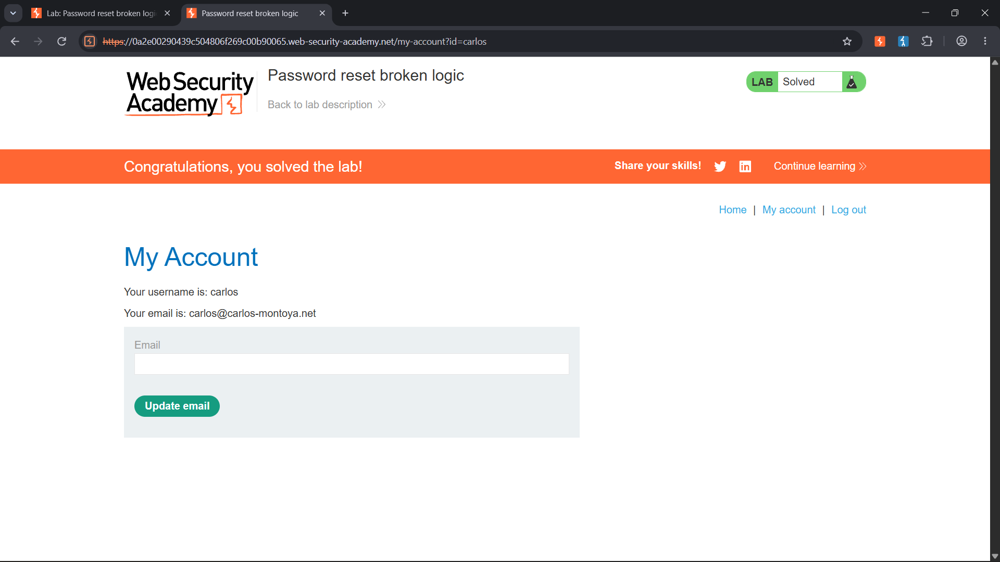

# Password Reset Broken Logic

**Platform:** PortSwigger Web Security Academy  
**Topic:** Authentication — Password Reset Logic Flaw / Account Takeover  
**Difficulty:** Apprentice  
**Status:** Solved

## Objective
Reset the password for the lab user `carlos` through a flaw in the password-reset workflow, then verify access to the account.

## Initial exploration
I first logged in with the provided `wiener` account and searched for a password-reset option. I could not find it because the application exposed **Forgot password** only while logged out. After logging out, I could access the reset workflow and request a reset for `wiener`.

## Methodology

### 1. Inspect the reset workflow
I used Burp Suite to inspect the HTTP requests generated during the password-reset process. I noticed a temporary reset-token parameter in both the URL and request body, alongside the username and the two new-password fields.

### 2. Test reset-token validation
In the authorized lab request, I removed the temporary token value from both locations, changed the account identifier from `wiener` to `carlos`, and supplied matching values in the two new-password fields. The application accepted the request and changed Carlos's password.

### 3. Verify the impact
I returned to the login page and authenticated as `carlos` using the password I had set. Successful login confirmed account takeover and completion of the lab.

**Lab solved.**

## Root cause
The password-reset endpoint did not correctly enforce the reset token and its association with the account being modified. A secure implementation must require a valid, unexpired, single-use reset token and bind it server-side to the exact account for which the reset was requested. A client-controlled username must never substitute for that proof.

## Security impact
This flaw can result in **account takeover**. An attacker may be able to set a new password for another user's account without knowing the existing password or possessing a valid reset token.

## How to prevent this vulnerability
- Require a cryptographically random reset token.
- Validate the token server-side on every password-reset attempt.
- Bind each token to one specific account.
- Enforce expiration and single-use semantics.
- Reject missing, invalid, expired, or already-used tokens.
- Invalidate outstanding reset tokens after a successful password change.
- Avoid exposing raw reset tokens in logs or diagnostic output.
- Monitor unusual password-reset attempts.

## What I learned
1. Application functionality can differ between authenticated and unauthenticated states.
2. Password-reset requests deserve the same scrutiny as login and session-management flows.
3. A token parameter is not a security control unless the server actually validates it.
4. Reset authorization must be bound to the intended account.
5. Verifying the result by logging in with the changed credentials confirmed the real impact.

## Evidence

The screenshot records successful completion of the password-reset lab.

## Scope
This exercise was performed only in the intentionally vulnerable PortSwigger Web Security Academy lab environment. The password reset and account access were limited to the lab instance.
