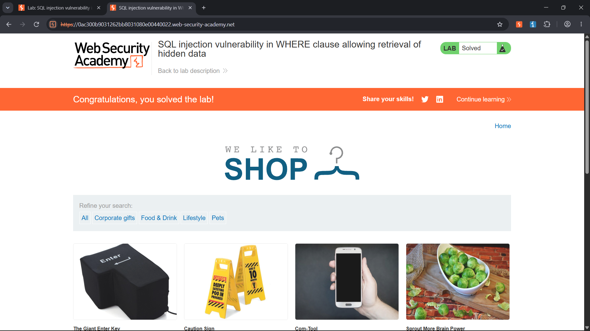

# SQL Injection — WHERE Clause Allowing Retrieval of Hidden Data

**Platform:** PortSwigger Web Security Academy  
**Category:** SQL Injection  
**Status:** Solved  
**Difficulty:** Apprentice

## Objective

The goal was to test the product-category filter for SQL injection and retrieve products that were hidden by the normal filtering logic.

## My Approach

### 1. Find the input that controls the filter

I browsed the shop and used the category filter. I then looked at the request in Burp Suite to identify where the selected category was being sent. The category value was the part I wanted to test.

### 2. Check how the input was handled

I first appended a single quote (`'`) to the category value (`Pets`) to see whether the input was being interpreted in a way that could affect the SQL query.

### 3. Test the condition

I then modified the category value with a boolean condition:

```
Pets' OR 1=1--
```

The idea was to make the condition evaluate as true for every row. Since `1=1` is always true, the injected condition could bypass the original category restriction. The `--` comment marker was used to comment out the remaining part of the SQL statement.

### 4. Observe the result

The application returned products beyond the normal category filter, including products that were not meant to be shown through that filter. This confirmed that the input was affecting the SQL query's logic.

### 5. Confirm completion

The lab displayed the successful completion message, confirming that the exercise was solved.

## Why the Payload Worked

The category filter was likely used inside a SQL `WHERE` clause. A vulnerable query could look conceptually like this:

```sql
SELECT * FROM products
WHERE category = 'Pets' AND released = 1
```

By injecting SQL syntax into the category value, the condition could be changed so that it became true for all rows. In this test, `OR 1=1` is always true, and the comment marker prevents the rest of the original query from interfering.

This is a simplified example to explain the logic, not a copy of the application's actual query.

## What I Learned

- A single quote can be a useful initial probe when testing whether input is being placed into a SQL query unsafely.
- The category filter is an HTTP request parameter, so I could test it by modifying the request in Burp rather than only interacting with the page.
- Boolean conditions such as `1=1` can change the logic of a SQL `WHERE` clause when input is injectable.
- SQL injection is not limited to database errors; it can also produce valid responses with altered results.
- I understand the basic reasoning behind this payload, but I want more practice deriving SQL injection tests independently rather than relying on hints.

## How I Would Prevent It

- Use parameterized queries / prepared statements so user input is treated as data, not SQL syntax.
- Avoid building SQL statements by concatenating user-controlled values.
- Validate category values against an allowlist of known categories.
- Use a database account with only the permissions the application needs.
- Add tests for database-backed filters and other input-controlled query features.

## Evidence

### Burp Repeater — injection test

**Burp request evidence:** will be added after the redacted screenshot is uploaded.

### Lab completion



> The request evidence should be sanitized before publishing: redact the session cookie and unique lab hostname.

## Scope

This exercise was performed in PortSwigger Web Security Academy's intentionally vulnerable training environment.
