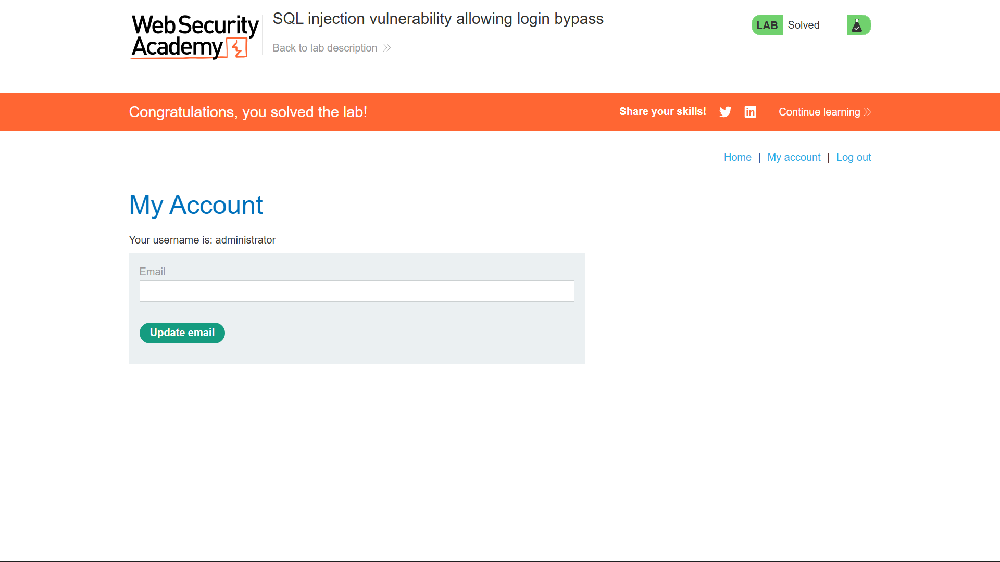

# SQL Injection — Login Bypass

## Objective

Test whether SQL injection in the login form could change the authentication query and allow access without valid credentials.

## My Approach

I read the lab description and focused on the username field, since it was likely used in the database query that checked the login details. I first added a single quote (`'`) to the username and observed the response. I also compared the behavior using a doubled single quote (`''`), to see how the application handled quote characters. Together with the response behavior, these initial probes gave me a reason to investigate the field for SQL injection.

I then used Burp Suite to inspect the login request more closely. The username was being sent before the password was checked, so I tested whether SQL comment syntax could make the rest of the query—including the password condition—be ignored. After sending the modified request, I was able to log in as the administrator without a valid password, and the lab marked the exercise as solved.

## Why It Worked

The application was handling user input unsafely while building its SQL query. The username field could affect the query's syntax, and the comment marker caused the remaining part of the query to be treated as a comment in this lab's database context.

The input was therefore influencing the authentication logic instead of being treated strictly as a username value.

## What I Learned

- Login forms are also SQL injection entry points when their inputs are used unsafely in database queries.
- The response to simple quote probes can help guide further testing, but should be considered alongside other evidence.
- Burp Repeater makes it easier to isolate a request and observe how small input changes affect the response.
- SQL injection can affect authentication and account access—not only the data displayed on a page.

## How I Would Prevent It

- Use parameterized queries / prepared statements so user input is data, not executable SQL.
- Avoid concatenating input directly into SQL statements.
- Use consistent safe database-access patterns across the application.
- Return generic authentication errors and avoid exposing detailed database errors.

## Evidence

Burp request screenshots are intentionally omitted from this repository.
