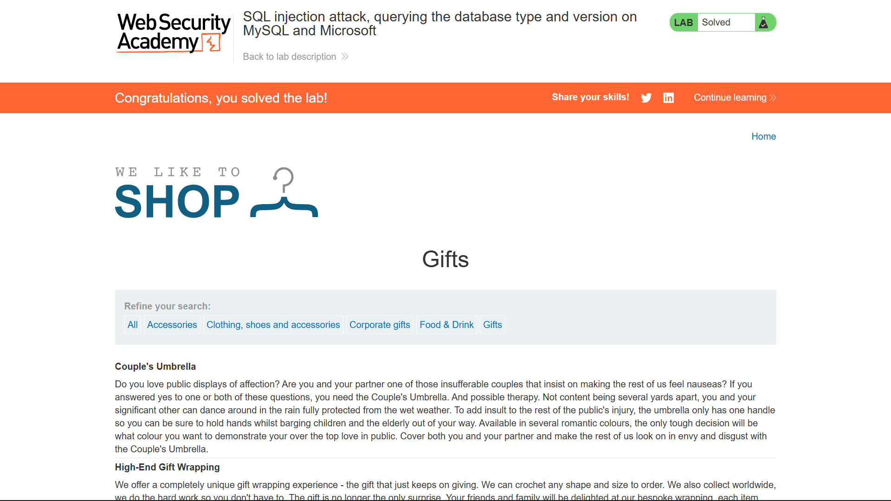

# SQL Injection — Database Version Disclosure (MySQL / Microsoft)

**Platform:** PortSwigger Web Security Academy  
**Category:** SQL Injection  
**Status:** Solved

## Objective

Use the vulnerable category filter to identify the database platform and retrieve its version information. This lab focused on adapting the UNION-based approach to the database syntax supported by the target.

## My Approach

I started by inspecting the product-category filter request in Burp Suite to find where the category value was being sent. I tested the parameter by adding a single quote (`'`) and then a doubled single quote (`''`) to compare how the application responded. The behavior suggested that the input was affecting the query's syntax, which gave me a lead to continue investigating SQL injection.

Next, I worked out the number of columns in the original query and checked which of them could display text. With that information, I consulted a SQL injection cheat sheet to find the appropriate database-version expression for the MySQL/Microsoft SQL Server variants covered by the lab. I appended the UNION-based query to the category value and inspected the response in Burp Repeater.

The response displayed database version information, and the PortSwigger completion banner confirmed that the lab was solved.

## Why It Worked

The category input was incorporated into a SQL query in an unsafe way, allowing the injected UNION statement to add a second result set. UNION-based tests need to match the original query's number of columns and use compatible data types; otherwise, the database rejects the query.

The version expression was specific to the database syntax used in this lab. Returning its result in a column displayed by the page allowed the version information to be read from the response.

## What I Learned

- Begin with a controlled input probe and observe the application's response before attempting a more complex test.
- Column count and data-type compatibility are important when using UNION.
- Database-specific syntax matters; a technique that works for one DBMS may not work for another.
- A normal-looking response page can expose backend details through an injectable query.

## How I Would Prevent It

- Use prepared statements / parameterized queries so input cannot become SQL syntax.
- Avoid directly concatenating request parameters into query strings.
- Allowlist expected category values wherever practical.
- Restrict database privileges and avoid exposing detailed database errors.

## Evidence

Burp request screenshots are intentionally omitted from this repository.
